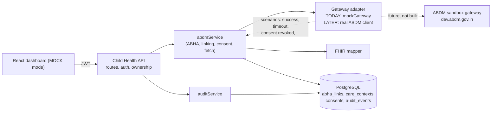
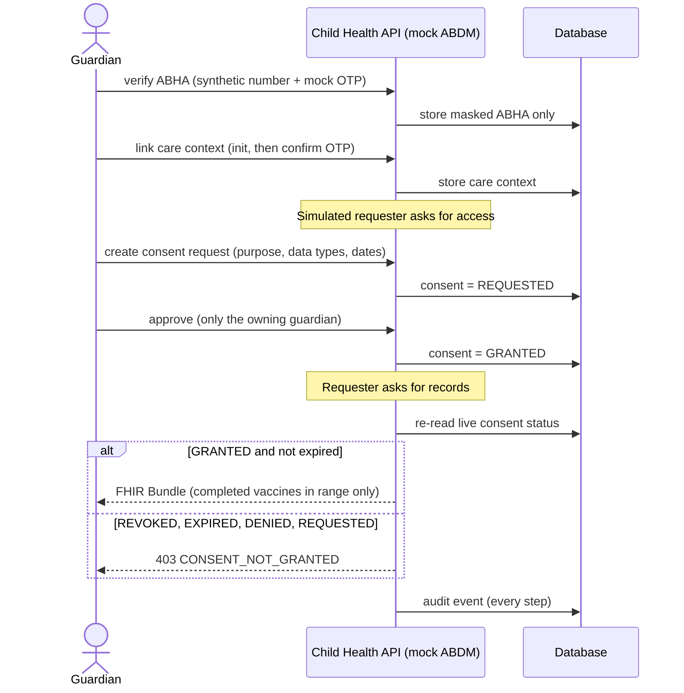

# ABDM integration design (Task B)

> **This prototype is a local mock. It is NOT a live ABDM integration.**
> It never contacts the ABDM sandbox or production, uses no real ABHA numbers, and uses synthetic
> data only. Every ABDM API response carries `"mock": true` and the header `X-ABDM-Mode: MOCK`.

How this document was prepared: the milestone descriptions, API paths, consent statuses, error
codes and go-live steps below were read from the official ABDM docs (`docs.abdm.gov.in`, HIE-CM V3)
on 3 Nov 2026. Where the docs did not state something, this document says so instead of guessing.

## 1. Key terms

| Term | Meaning (from the official glossary) |
|---|---|
| **ABDM** | Ayushman Bharat Digital Mission, India's digital health programme. |
| **HIE-CM** | Health Information Exchange and Consent Manager: a gateway that manages an individual's consent for their health data and supports consent-based exchange between participants. |
| **ABHA** | Ayushman Bharat Health Account: the person's health identity (an ABHA Number, optionally with an ABHA Address). |
| **HIP** | Health Information Provider: holds a person's records and shares them only under a valid consent artefact. WombTo18 would act as a HIP for immunisation records. |
| **HIU** | Health Information User: an entity that requests records, only after the person grants consent. |
| **Care context** | A logical group of a person's records at a HIP, with a reference number and a display name (here: "Immunisation record"). |
| **Consent artefact** | A machine-readable record of a granted consent: purpose, health-information types, date range, expiry, parties. |

### ABHA vs FHIR

They solve different problems and are often confused:

- **ABHA is identity.** It answers "who is this person?" It is a number/address that links a
  person's records across providers.
- **FHIR is the data format.** It answers "what does the record look like?" ABDM uses FHIR R4
  profiles published by NRCeS. A record is exchanged as a FHIR Document Bundle.

In this project: ABHA verification is milestone M1 (identity), and the immunisation record is
mapped to a FHIR Bundle (data format) in `backend/src/fhir/mapper.js`.

## 2. ABDM milestones (official)

| Milestone | Role | Purpose per the official page | In this prototype |
|---|---|---|---|
| **M1** Identity | - | "Identity for every patient, created and verified." | Mock ABHA verification |
| **M2** Health Information Provider | HIP | "Link care contexts and serve them under consent." | Mock care-context linking and consent-gated data sharing |
| **M3** Health Information User | HIU | "Request consent, fetch and decrypt." | Simulated: a "requester" asks the guardian for consent |
| **M4** Registry Integration | - | "Get the ids every call needs" (facility and professional registries). | **Not built** |

## 3. Design: an integration layer between our API and ABDM

The rest of the app should never know ABDM details. All ABDM behaviour sits behind one layer, so
that swapping the mock for the real gateway changes one place.

### Where the real ABDM calls would go

The official M2 and M3 pages list these V3 paths. The mock does **not** call or serve them; the
table shows which mock endpoint stands in for each real step.

| Real step (official path) | Direction | Mock equivalent in this repo |
|---|---|---|
| `POST /api/v3/hip/patient/care-context/discover` | gateway to HIP | not modelled (we link directly) |
| `POST /api/v3/hip/link/care-context/init` | gateway to HIP | `POST /abdm/children/:id/care-contexts/link-init` |
| `POST /api/v3/hip/link/care-context/confirm` | gateway to HIP | `POST /abdm/children/:id/care-contexts/link-confirm` |
| `POST /api/v3/consent/request/hip/notify` | gateway to HIP | `POST /abdm/consents/:id/approve` (guardian decision) |
| `POST /api/v3/hip/health-information/request` | gateway to HIP | `POST /abdm/consents/:id/health-information` |
| `POST /api/hiecm/consent/v3/request/init` (HIU) | HIU to gateway | `POST /abdm/children/:id/consents` (simulated requester) |
| `POST /api/v3/hiu/consent/request/notify` (HIU callback) | gateway to HIU | not modelled |

Real HIP flows are callback-based: the gateway calls our endpoints and we answer with an `on-...`
call. The mock collapses this into one request/response per step to stay simple. A real integration
would need the callback endpoints, `REQUEST-ID` handling and the session token, none of which is
built here. Also not stated by the official sandbox page, and therefore not assumed: the token
endpoint path, token lifetime and `TIMESTAMP` format; these must be read from the API reference.

### Mock flow end to end

## 4. Authentication, consent, errors, audit

### Authentication
- **Our API:** mock guardian login returning an HS256 JWT (1 hour). **Mock only; not production
  auth.** In production the mock login is switched off (`NODE_ENV=production`), so a real identity
  provider (for example Amazon Cognito) must be added first.
- **Towards ABDM (not built):** per the official sandbox page, calls carry a token derived from a
  client ID and client secret issued after sandbox approval, sent to the gateway with
  `X-CM-ID: sbx`. The secret belongs in a secrets manager, never in the code or a browser.

### Consent: two separate things
1. `children.consentStatus` (`pending`, `granted`, `revoked`): the guardian's consent to
   WombTo18 processing the child's data at all.
2. **ABDM consent records** (per request): purpose, data types, date range, expiry and status
   `REQUESTED`, `GRANTED`, `DENIED`, `REVOKED`, `EXPIRED` (the statuses on the official M3 page).

Sharing records requires **both**: the child's `consentStatus` must be `granted` and the ABDM
consent must be `GRANTED` and unexpired. A client-supplied `consentStatus` is only a recorded
statement; this prototype does not verify it.

Rules implemented:
- Only the guardian who owns the child can approve, deny or revoke. Anyone else gets a 404.
- Repeating a decision is a harmless no-op (the real gateway can deliver a callback twice).
- A decision cannot be reversed (approving a `REVOKED` or `DENIED` consent is a 409).
- Expiry is computed on every read; consents cannot be requested for more than 90 days.
- **Revocation takes effect immediately:** every fetch re-reads the consent status; nothing is cached.
- Data minimisation: only *completed* vaccinations inside the consented date range are shared;
  no guardian name, no full ABHA number.

### Errors
All errors share one shape: `{ "error": { "code", "message", "details?", "requestId" } }`.
Codes taken from the official docs are used only where the meaning matches; every other code is a
plain name and not an ABDM code.

| Situation | Status | Code | Official code it is modelled on |
|---|---|---|---|
| Consent revoked, expired or not given | 403 | `CONSENT_NOT_GRANTED` | `ABDM-1062` |
| Care context already linked | 409 | `CARE_CONTEXT_ALREADY_LINKED` | `ABDM-1056` |
| Step done out of order (e.g. link before ABHA verified) | 409 | `ABHA_NOT_VERIFIED` | `ABDM-2406` |

### Mock gateway error scenarios
Send `X-Mock-Scenario: <name>` on any `/abdm` request (or use the dropdown in the dashboard).

| Scenario | Result |
|---|---|
| `success` | normal behaviour |
| `invalid_auth` | 401 `GATEWAY_UNAUTHORIZED` |
| `invalid_request` | 400 `GATEWAY_INVALID_REQUEST` |
| `consent_denied` / `consent_expired` / `consent_revoked` | 403 with that code |
| `timeout` / `unavailable` | bounded retry (3 attempts), then 504 / 503 with `attempts: 3` |
| `transient_failure` | fails once, succeeds on attempt 2; exactly one record is created |
| `duplicate_callback` | processed once and flagged `duplicateCallbackIgnored`; refused (400) on operations that are not idempotent |

There are **no unlimited retries**: at most 3 attempts, and the real operation is never re-run after
it has succeeded, so a retry cannot apply a change twice. OTP entry is also bounded (3 wrong codes
end a link transaction).

### Audit
Every ABDM action writes an `audit_events` row: event id, request id, event type, actor, child,
consent, timestamp, outcome (`SUCCESS`, `DENIED`, `FAILURE`) and a reason code. It stores
**references only**: never ABHA numbers, OTPs, tokens, secrets or health records (a test checks this).
It is separate from the HTTP access log. A guardian sees only their own actions on their own
child; another user's failed attempt is recorded for operators but not shown to the owner.
Known gaps: requests rejected by input validation are not audited, and the table is not
tamper-proof (see `security.md`).

## 5. FHIR output
`GET`-ing health information returns a FHIR R4-shaped **document Bundle**: `Composition`,
`Patient`, `Organization` and one `Immunization` per shared vaccine, all synthetic. It uses core
FHIR structure only, sets no `meta.profile`, and **has not been validated against the ABDM FHIR
implementation guide** (the profile page could not be fetched), so it must not be called
ABDM-compliant. Vaccines are free text; no vaccine codes were invented. The reminder due date
stands in for the date given, a prototype shortcut. The real transfer is **encrypted** (the HIP
encrypts with the requester's public key using ECDH, per the M2 page); the mock returns plain JSON
and says `encrypted: false`.

## 6. From sandbox to production (official process)
Summarised from the "Go live" page; none of these steps has been started.

1. Get **sandbox credentials**: apply through the sandbox application; the Health Tech Committee approves; a client ID and secret are then issued.
2. Build and finish **every milestone** your integration needs, end to end, in the sandbox.
3. **Stage 4, test, review and audit** (once, for the whole integration):
   functional testing by an empanelled agency; NHA review and demo; a security audit by an STQC-approved or CERT-In-empanelled agency (Web Application Security Assessment, producing a *Safe to Host* certificate); the sandbox exit form with the reports, a GSTIN certificate and a signed undertaking.
4. **Stage 5:** demonstration to the Health Tech Committee (guideline compliance, milestones, functional readiness, security).
5. **Stage 6, go live:** NHA emails a *production* client ID and secret. Switch the gateway from `https://dev.abdm.gov.in` (with `X-CM-ID: sbx`) to `https://apis.abdm.gov.in`, and the ABHA service to its production host. Mixing production credentials with sandbox hosts (or the reverse) fails.

Realistic note: steps 3 and 4 involve external agencies and paperwork, so they cannot be completed
inside an internship assessment.

## 7. MCP and AI tools versus the real ABDM APIs versus this mock

Three different things that are easy to mix up:

| | What it is | Used when | Talks to real ABDM? |
|---|---|---|---|
| **ABDM sandbox / production APIs** | The real gateway and ABHA services. | Runtime of a real integration. | Yes |
| **ABDM Docs MCP server and skills** | A documentation helper for AI coding tools. The official page describes an MCP endpoint at `https://docs.abdm.gov.in/mcp` with tools such as `search_docs`, `decode_error`, `validate_request`, `list_operations`, plus optional skills installed under `.claude/skills`. | **Development time**, while writing code. | No. It serves documentation, not patient data or live calls. |
| **This repo's mock** | Local Express code with synthetic data and simulated failures. | Demo and tests. | **No** |

The runtime mock **does not depend on MCP**. The API runs without any MCP server or AI tool. The
official page itself says code produced with AI help must be checked against the documentation and
tested in the sandbox. I attended the 30 Oct 2026 workshop on this and understood the concepts, but
did not complete the hands-on setup (no licence at the time); the milestone and path information in
this document was read from the official documentation pages instead.

## 8. Limitations (be upfront)
- Mock only; no real ABDM calls, no callbacks, no gateway session token, no encryption of transfers.
- M4 (registries), discovery, HIU-side data receipt and decryption are not built.
- ABHA numbers are synthetic and start with `00-`; the mock OTP is public (`123456`).
- Purpose codes (`CAREMGT`, `PUBHLTH`, `HPAYMT`) and the `ImmunizationRecord` type are an
  illustrative subset; confirm against the official code lists before any real use.
- Link transactions are kept in server memory and lost on restart.
