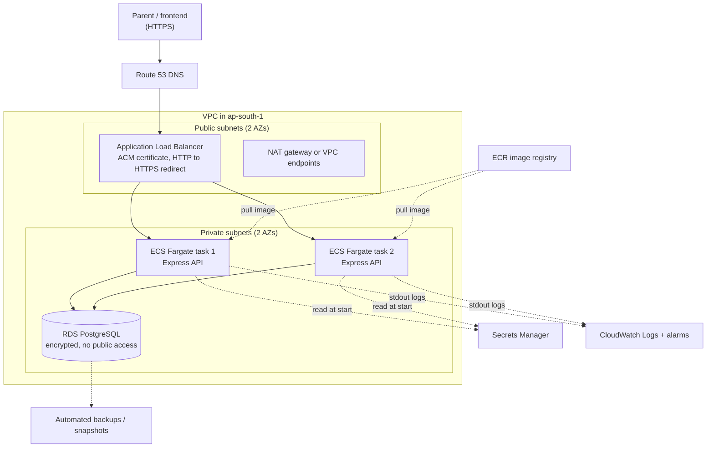

# AWS deployment plan (Task C)

> **This is a plan only. Nothing has been deployed to AWS, no AWS account was used, and no AWS
> money was spent.** Every cost below is a rough estimate to be checked in the AWS Pricing
> Calculator before any real decision.

## 1. Summary

| Need | Choice | One-line reason |
|---|---|---|
| Compute | **ECS on Fargate** (2 small tasks) | The API is already a container (`backend/Dockerfile`); no servers to patch; steady database connections. |
| API exposure | **Application Load Balancer** (ALB) | Works naturally with containers, health checks on `/health`, and HTTPS. |
| Database | **RDS for PostgreSQL 16**, private subnet | Same engine as local development; managed backups and encryption. |
| Secrets | **AWS Secrets Manager** | Database password and signing secret never live in the image or in git. |
| HTTPS | **ACM certificate** on the ALB | Free public certificates, automatic renewal. |
| Logging | **CloudWatch Logs** (+ alarms) | The app already writes JSON logs to stdout. |
| Backup | **RDS automated backups + point-in-time recovery** | Recover to any minute in the retention window. |
| Region | **ap-south-1 (Mumbai)** | Keeps children's health data in India (confirm the legal requirement with WombTo18's compliance team). |

## 2. Architecture

Network rules (security groups, least access):
- **ALB**: inbound 443 (and 80 only to redirect) from the internet.
- **API tasks**: inbound 3000 **only from the ALB's security group**.
- **RDS**: inbound 5432 **only from the API tasks' security group**; not publicly accessible.

## 3. Compute: ECS Fargate vs Lambda

| | **ECS Fargate (chosen)** | **Lambda (behind API Gateway)** |
|---|---|---|
| Fit for this app | Express app runs as is, from the existing Dockerfile. | Needs an adapter around Express and a different packaging. |
| Database connections | A few long-lived pooled connections. | Many short-lived instances can exhaust Postgres connections; needs RDS Proxy (extra cost and setup). |
| In-memory features | Per-task memory still needs care (see 7). | Worse: each invocation environment is short-lived. |
| Idle cost | Pays for running tasks even with no traffic. | Pays only per request; very cheap at low traffic. |
| Cold starts | None for running tasks. | Possible latency spikes. |
| Operations | Scaling and deployments via ECS services. | Less to manage per function, but more moving parts around it. |

Why Fargate here: steady, small traffic, an existing container, and Postgres. Lambda would be the
cheaper choice only if traffic were very low and spiky; that trade-off is worth saying out loud.

## 4. API exposure: ALB vs API Gateway

| | **ALB (chosen)** | **API Gateway** |
|---|---|---|
| Best for | Container services | Lambda-backed APIs; usage plans, API keys, per-route throttling |
| Health checks | Built in (`GET /health`) | Not applicable to containers directly |
| Cost shape | Fixed hourly charge plus usage | Per request |
| Extras | Optional AWS WAF | Built-in throttling and request validation |

An ALB is simpler for Fargate. Add **AWS WAF** on the ALB (rate rules, common-attack rules) once
the pilot grows. If Lambda were chosen later, API Gateway would take this role.

## 5. Data, secrets, HTTPS, logging, backup

**Database (RDS PostgreSQL 16)**
- Private subnets only, `PubliclyAccessible = false`, storage encryption on (AWS KMS), TLS required (`rds.force_ssl`).
- Pilot: single-AZ `db.t4g.micro`-class instance. Production: Multi-AZ and a larger class.
- Schema changes: run `npm run migrate` as a **one-off ECS task** using the same image, before each deploy (never from a laptop against production).

**Secrets (Secrets Manager)**
- Stored: the database credentials and `JWT_SECRET` (until a real identity provider replaces the mock login). Later: ABDM client ID and secret.
- Injected into the task as environment variables at start via the ECS task definition's secrets block. Nothing secret is baked into the image; `.env` is git-ignored and only `.env.example` is committed.
- Rotate the database secret on a schedule; the API reads credentials at start, so a rolling restart picks up changes.

**HTTPS**
- ACM public certificate for the API domain on the ALB; listener 80 redirects to 443; modern TLS policy (TLS 1.2 or higher).
- Traffic from the ALB to tasks stays inside the private VPC; end-to-end TLS to the tasks can be added if required.

**Logging and monitoring**
- Tasks write structured JSON to stdout; the `awslogs` driver sends it to CloudWatch Logs with a retention period (for example 30 days).
- **No health data in logs**: the access log records method, path, status and duration only, never bodies; audit events hold ids only. Keep it that way in production.
- Alarms: ALB 5xx rate, unhealthy task count, RDS CPU, free storage and connections, and ABDM-related failure spikes.

**Backup and recovery**
- RDS automated backups with 7-day retention and point-in-time recovery; a manual snapshot before risky migrations.
- Deletion protection on the database; copy snapshots to a second region only if required.
- A backup is only real once a restore has been tested: schedule a restore drill into a scratch instance.

## 6. Identity and permissions (least privilege)
- **Task execution role:** pull from ECR, write to its own log group, read **only** its own named secrets.
- **Task role** (what the running app may do): none until needed; later only the specific actions it uses.
- **Humans:** SSO or MFA-protected IAM roles; no shared admin keys; no long-lived access keys in CI (use GitHub OIDC to assume a deploy role).
- **Deploy pipeline (proposed):** build image, scan, push to ECR, run migration task, update the ECS service with rolling deployment and automatic rollback on failed health checks.

## 7. Things in this code that must change before it runs on more than one task
These are real limitations of the current prototype, not hypotheticals:
- **Rate limiting is in memory per process.** With two tasks, a client gets two separate limits. Use a shared store (for example ElastiCache Redis) or enforce limits at AWS WAF.
- **ABDM link transactions are in memory.** A restart or a request landing on the other task loses them; they need a database table or Redis.
- **Mock login must stay off.** It is already disabled when `NODE_ENV=production`, which means a real identity provider (for example Amazon Cognito) is needed first.
- The ABDM mock routes should be removed or feature-flagged off in a real production image.
- **Trust proxy:** behind an ALB, the app must set Express `trust proxy` so rate limiting sees the real client IP.

## 8. Pilot cost estimate (rough, NOT a quote)

Assumptions: Mumbai region, 2 Fargate tasks of 0.25 vCPU / 0.5 GB running 24x7, one single-AZ
`db.t4g.micro`-class PostgreSQL with 20 GB storage, one ALB, light traffic (a few thousand requests
a day), 5 GB of logs a month, 1 to 2 secrets, 7-day backups within the free allocation.
Figures are **approximate USD per month from general knowledge, not from the live AWS price list**.

| Item | Approx. USD / month |
|---|---|
| Fargate (2 small tasks) | 15 to 25 |
| RDS PostgreSQL (single-AZ, micro) plus 20 GB storage | 15 to 25 |
| Application Load Balancer | 18 to 25 |
| NAT gateway (if used) | 35 to 45 |
| CloudWatch Logs and alarms | 3 to 8 |
| Secrets Manager (2 secrets) | about 1 |
| Route 53 hosted zone | about 0.5 |
| ACM certificate | free |
| ECR image storage | about 1 |
| **Total without NAT gateway** | **roughly 55 to 90** |
| **Total with one NAT gateway** | **roughly 90 to 135** |

Ways to keep the pilot cheap: skip the NAT gateway by using VPC endpoints for the few AWS services
needed (or, for a throwaway pilot only, placing tasks in public subnets with inbound access locked
to the ALB); one task instead of two while testing; stop non-production environments outside working
hours. Costs rise with Multi-AZ RDS (about double the database line), WAF (a monthly fee plus per-rule
and per-request charges) and data transfer.

## 9. Not done yet (honest list)
- No AWS account, Terraform or CloudFormation was written; this is a design document.
- No load test, so the sizing above is a starting guess.
- No compliance review (data residency, retention periods, DPDP Act obligations): needs WombTo18's legal and security team.
